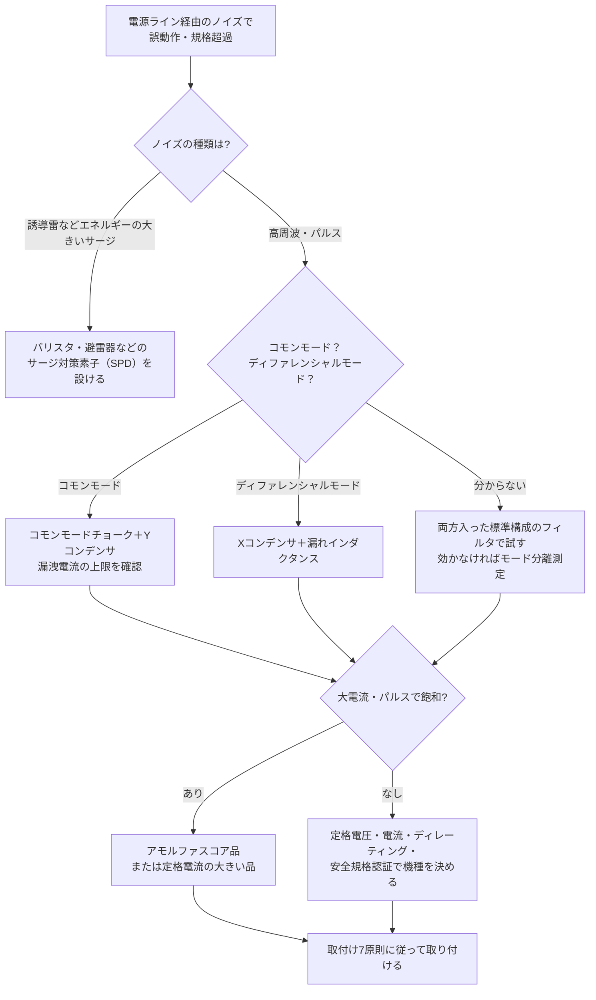

# ノイズフィルタ（電源ライン用EMCフィルタ）

**対象読者**: :material-account-hard-hat: 電気担当 / :material-account-wrench: 保全担当

---

## 30秒まとめ

> ノイズフィルタは「付ければ効く」部品ではありません。**ノイズがコモンモードかディファレンシャルモードかを先に見極め**、効く部品を選びます。
> 取付け方を誤ると、フィルタ本来の特性が出ません。アース線は太く短く、入力線と出力線は離し、電源はすべてフィルタの出力側から取ります。
> Y コンデンサは大きいほどノイズに効きますが、**漏洩電流が増えます**。フィルタのケースは必ず接地します。

ノイズの種類（誘導・静電・電源ライン）と現場の切り分けは [接地・ノイズトラブル](../06-trouble/grounding-noise.md) を先に参照してください。本ページはその中の「電源ラインノイズ」を止める部品、ノイズフィルタの中身と使い方を扱います。

---

## ノイズ障害は3要素がそろって起きる

ノイズ障害は **発生源 → 伝達経路 → 障害を受ける機器（被害側）** の3つがそろったときにだけ起きます。どれか1つを断てば障害は起きません。

| 要素 | 対策の方向 | 例 |
|------|-----------|-----|
| 発生源 | 発生エネルギーを弱くする | インバータのキャリア周波数を下げる・サージアブソーバ |
| 伝達経路 | 伝わりにくくする | **ノイズフィルタ**・シールド・離隔・ツイスト |
| 被害側 | 障害を受けにくくする | 信号絶縁器（アイソレータ）・入力フィルタ |

伝わる経路は、ケーブルやプリント配線を伝わる**伝導ノイズ**と、空間を伝わる**放射ノイズ**の2つです。伝導ノイズはケーブルがアンテナになると放射ノイズに変わり、放射ノイズはケーブルに乗ると伝導ノイズに戻ります。そのため、**発生源のできるだけ近くで止める**のが基本です。ノイズフィルタは、電源ラインを伝わる伝導ノイズを発生源の近く（または被害側の入口）で止める部品です。

---

## コモンモードとディファレンシャルモード — 先に見極める

伝導ノイズは、電流の流れ方で2つに分かれます。**どちらかで効く部品が違う**ため、ここを間違えると「フィルタを追加したのにノイズが増えた」ということが起きます。

| | ディファレンシャルモード（ノーマルモード） | コモンモード |
|---|---|---|
| 英語 | Differential mode / Normal mode | Common mode |
| 流れ方 | 電源線の往き線→負荷→帰り線と流れる。**往きと帰りで向きが逆** | 往き線・帰り線の両方を**同じ向き**に流れ、接地・金属フレーム・浮遊容量を通って戻る |
| 戻り道 | 電源線どうし（狭いループ） | 大地・盤筐体・モーターフレームなど（**大きなループ**） |
| 放射のしやすさ | 往復の電流が打ち消し合うので放射は小さい | ループが大きく、**小さな電流でも大きく放射する** |
| 効く部品 | X コンデンサ（線間）・ノーマルモードチョーク | コモンモードチョーク・Y コンデンサ（線－接地間） |

```text
【ディファレンシャルモード】
往き線 → 負荷 → 帰り線 → 電源へ戻る
（線間の狭いループ）

【コモンモード】
往き線・帰り線（同じ向き）→ 負荷
→ 浮遊容量・フレーム → 接地・大地 → 電源へ戻る
（大地を通る大きなループ）
```

!!! tip "放射ノイズ対策ではコモンモードを優先する"
    コモンモード電流は大きなループを作るので、放射ノイズの主な原因になります。計器が離れた場所で暴れる・ラジオや無線に雑音が乗る、という症状はコモンモードを先に疑います。
    インバータ・モーター系では、モーター巻線とフレームの間の浮遊容量を通ったコモンモード電流が接地系へ流れ、計装の接地・シールドを経由して信号に乗る経路が典型です（[グランドと接地](../03-keiso/grounding-gnd.md)）。

!!! warning "通したい信号まで削らない"
    ノイズ対策部品は高い周波数を落とす低域通過形（LPF）です。通したい信号の帯域がノイズの周波数と重なると、信号の立ち上がりが遅くなります。電源ラインでは問題になりにくいですが、**信号線・通信線に同じ発想でフィルタを入れるときは信号の帯域を必ず確認**します。

---

## 電源ラインノイズの3分類 — フィルタが効くのは高周波ノイズ

電源ラインに乗るノイズは、電圧と立ち上がり時間とエネルギーで3つに分かれます。**一般のノイズフィルタは高周波ノイズ用に設計されています。**

| 種類 | 主な発生源 | 電圧の目安 | 立ち上がり時間 | エネルギーの目安 | 主な対策部品 |
|------|-----------|-----------|--------------|---------------|-------------|
| 高周波ノイズ | コンピュータ・スイッチング電源などのスイッチング周波数の高調波 | 〜数 V | ― | 数 mJ | **ノイズフィルタ** |
| パルスノイズ | リレー・誘導モーターの動作時 | 〜数 kV | 1 ns 以下 | 数百 mJ | 飽和しにくいコア（アモルファス等）のノイズフィルタ |
| サージノイズ | 誘導雷 | 〜数十 kV | 0.5 μs 以下 | 数 J〜数 kJ | バリスタ・避雷器などのサージ対策素子（SPD） |

数値はメーカー資料（下記「根拠」）の目安です。規格値ではありません。

- **パルスノイズ**はエネルギーが大きく、フィルタのコアを**磁気飽和**させることがあります。飽和するとインダクタンスが落ち、フィルタが効かなくなります（後述「コアの飽和」）。
- **誘導雷などのサージ**はエネルギーが非常に大きい（数 J〜数 kJ）ため、バリスタ・避雷器などのサージ対策素子（SPD: サージ防護デバイス）を用います。数 kV 級のパルス性のサージにはノイズフィルタも使われますが、コアの飽和で効果が落ちることに配慮が要ります（後述「コアの飽和」）。

---

## ノイズフィルタの中身

単相の電源用ノイズフィルタは、次の部品でできています。

```text
入力側
  ↓ Cx・R（線間）
  ↓ L1 コモンモードチョーク（L2 ＝ その漏れインダクタンス）
  ↓ Cx（線間）
  ↓ Cy×2（各線とケース FG の間）
出力側
```

| 記号 | 部品 | 接続 | 効くノイズ | 役割 |
|------|------|------|-----------|------|
| Cx | X コンデンサ | 線間 | ディファレンシャルモードだけ | 線間のノイズを短絡して戻す。1 μF 程度の比較的大きな容量。150 kHz〜1 MHz の低い帯域で特に効く |
| R | 放電抵抗 | 線間 | ― | 電源を切った後に Cx の残留電荷を抜く |
| L1 | コモンモードチョークコイル | 両線を同じコアに巻く | コモンモード | 同じ向きの電流（コモンモード）にだけ大きなインピーダンスになる。往復電流（負荷電流）は磁束が打ち消すので通す |
| L2 | ディファレンシャルモードインダクタンス | ― | ディファレンシャルモード | 多くの場合、L1 の**漏れインダクタンス**（数〜数十 μH）を利用する |
| Cy | Y コンデンサ | 各線とケース（FG）の間 | コモンモード（2個が線間で結合するので、ディファレンシャルモードにも効く） | コモンモード電流を FG へ逃がす。通常2個使う。ディファレンシャルモードへの効果は 8〜10 MHz 付近の高い帯域で大きい |

それぞれのモードから見ると、フィルタは次の等価回路になります。

- **ディファレンシャルモードから見る**: Cx1 → 漏れインダクタンス → Cx2 ＋ Cy/2（Cy 2個が線間で直列になる）
- **コモンモードから見る**: コモンモードチョーク L → 2Cy（Cy 2個が接地に対して並列になる）

### 部品の大きさにはトレードオフがある

| 大きくしたいもの | 得られる効果 | 代わりに起きること |
|---------------|------------|-----------------|
| Y コンデンサの容量 | コモンモードがよく落ちる | **漏洩電流が増える**（感電・漏電遮断器の不要動作・絶縁監視の誤報） |
| コモンモードチョークの漏れインダクタンス | ディファレンシャルモードも落ちる | コアが**飽和しやすくなる** |

---

## Y コンデンサと漏洩電流 — ケースは必ず接地する

Y コンデンサは線とケースの間につながっているため、電源の周波数で常に小さな電流がケース（アース）へ流れます。これがノイズフィルタの**漏洩電流**です。

**漏洩電流 I = 2πfCE**（f: 電源周波数、C: Y コンデンサの静電容量、E: Y コンデンサに加わる対地電圧）

!!! example "計算例（Y コンデンサ 4700 pF、対地電圧 100 V の場合）"
    - 50 Hz: I = 2π × 50 × 4700×10⁻¹² × 100 ≒ 0.15 mA
    - 60 Hz: I = 2π × 60 × 4700×10⁻¹² × 100 ≒ 0.18 mA

    1台では小さい値です。しかし、ノイズフィルタを内蔵した機器（インバータ・スイッチング電源・PLC 電源など）を**同じ回路に何台もつなぐと、漏洩電流は台数分足し合わさります**。周波数 f に比例するので、60 Hz 地域は 50 Hz 地域より 2 割大きくなります。

この漏洩電流が現場で起こす問題は3つです。

1. **感電** — フィルタのケースやアース端子が接地されていないと、漏洩電流は機器に触れた人体を通って大地へ流れます。**ノイズフィルタのケース（アース端子）は必ず接地**します。UL などの安全規格が漏洩電流の上限を決めているのはこのためです。
2. **漏電遮断器の不要動作** — 回路の漏洩電流の合計が漏電遮断器（ELCB）の感度に近づくと、地絡が無くてもトリップします。切り分けは [保護装置誤動作](../06-trouble/protection.md) の「ELCB 頻繁トリップ」、漏れ電流の判定目安は [測定器の使い方](../05-hozen/instruments.md) が正典です。
3. **絶縁監視の誤報・見逃し** — Y コンデンサの電流は容量分（Ioc）です。ノイズフィルタ内蔵機器が多い回路では Ioc が支配的になり、Io 方式の絶縁監視では劣化（Ior）が埋もれます。[絶縁監視（常時監視）](insulation-monitoring.md) を参照してください。

!!! warning "コモンモード対策と漏洩電流はトレードオフ"
    コモンモードノイズが規格を超えたからといって Y コンデンサを大きくすると、漏洩電流が増えます。Y コンデンサで足りないときは、コモンモードチョークを大きくする・フェライトコアを追加するなど、**漏洩電流を増やさない手段**を先に検討します。

!!! warning "絶縁抵抗測定の前にフィルタを外す"
    ノイズフィルタやその先の電子機器が測定範囲に入ったままメガーをかけると、内蔵のサージ吸収素子や電子機器を傷めたり、測定値を誤ったりします。端子を外す・切り離すの手順は [絶縁管理](../05-hozen/insulation-management.md) が正典です。

---

## 仕様書の読み方

カタログで確認する項目と、読み違えやすい点をまとめます。

| 項目 | 意味 | 読み違えやすい点 |
|------|------|-----------------|
| 定格電圧 | 使用温度範囲で使える最大の AC 電圧（実効値） | 単相用と三相用がある。系統の電圧と相数に合わせる |
| 定格電流 | 使用温度範囲で流せる最大の負荷電流（実効値）。内部部品の耐熱で決まる | **周囲温度が高いと定格電流を下げて使う**（ディレーティング）。例として、ある機種は周囲温度 70 ℃で定格の約 70 % まで下げる。盤内温度で確認する |
| 漏洩電流 | 定格電圧をかけたときに各線からケースへ流れる電流 | 上の I = 2πfCE で決まる。**50 Hz と 60 Hz のどちらの値か**を確認する |
| 減衰特性（静特性） | 周波数ごとの減衰量（dB）。ノーマルモードとコモンモードの2本で示す | 減衰量 = 20 log₁₀（e₂/e₁）。e₂ はフィルタなし、e₁ はフィルタありの受信レベル。**測定治具（バラン）で整えたインピーダンスで測った値**なので、実機の電源・負荷のインピーダンスでは同じ減衰量にならないことがある |
| 直流抵抗 | フィルタ内の抵抗の合計（ほとんどがコイルの巻線抵抗） | 直流抵抗 × 負荷電流 がフィルタでの**電圧降下**になる。大電流回路で確認する |
| 温度上昇 | 定格電流を流したときのケース表面の温度上昇 | 空気中に置いた状態の値。金属板に取り付けた場合や強制冷却では小さくなる |
| 試験電圧（耐電圧）・絶縁抵抗 | 製品として保証している絶縁性能 | 製品仕様の値であり、設備の竣工・定期試験の判定値ではない。設備の耐圧試験は [耐圧試験・絶縁診断](../01-koatsu/insulation-test.md) が正典 |
| 安全規格の認証 | UL・EN などの認証 | ノイズフィルタは電源の一次側につながるため、感電・発煙・発火を防ぐ安全規格の認証品を選ぶ。輸出機器は輸出先の認証を確認する |

---

## 取付け7原則 — 取付け方で効果が変わる

カタログ通りの減衰量が出ない原因の多くは取付け方です。現場で盤を見るときの基準として使えます。

| # | 原則 | 理由 |
|---|------|------|
| 1 | **ノイズ源と被害側機器をシールドする** | 放射で直接飛ぶノイズはフィルタを通らない |
| 2 | **ノイズ源をフィルタや電源線に近づけない** | 近いと放射で電源線に再び乗り、フィルタの効果が消える |
| 3 | **筐体（盤）にノイズ電流を流さない** | 筐体を戻り道にするとノイズ電流が盤全体に広がる。戻り線を配線で返す |
| 4 | **電流ループを小さくする**（往復線をツイスト） | ループ面積が大きいほど放射・誘導を受けやすい |
| 5 | **フィルタの入力線と出力線を確実に離す** | 入力線と出力線が近いと、ノイズが**フィルタを飛び越えて**出力側へ結合する |
| 6 | **電源はすべてフィルタの出力側から取る** | フィルタの入力側から分岐した配線（例: ファン）は、ノイズを盤内へ持ち込むアンテナになる |
| 7 | **フィルタのアース線は太く短く**。金属ケースは筐体へ直接取り付け、**取付け面の塗装を剥がす** | アース線が長いとインダクタンスが入り、高い周波数でフィルタが効かなくなる |

!!! danger "アース線の長さで高周波の減衰が消える"
    メーカーの比較では、スイッチング電源のノイズフィルタのアース線を 0 cm・10 cm・20 cm と延ばすと、雑音端子電圧のスペクトルが長いほど高い周波数で持ち上がりました。電線は高い周波数ではインダクタとして働くためです。
    プラスチックケースや、金属ケースでも接地されていない場合にリード線で接地するときは、**できるだけ短く**します。

### 現場の改善事例（メーカー資料より）

| 事例 | 原因 | 対策 | 該当する原則 |
|------|------|------|-------------|
| ブレーカの配置で入出力が近接 | ブレーカをフィルタの横に置いたため、入力側と出力側の電源ケーブルが近づき、出力側のノイズが入力側へ回り込んだ | ブレーカの取付け位置をずらし、ケーブル間の距離を確保 | 5 |
| フィルタと機器本体が離れている | フィルタを収めたトランスボックスと機器本体の間のグランドが弱く、高周波のノイズレベルが高かった | 専用のシールド金属配管でボックスと本体を結び、間のインピーダンスを下げた | 3・7 |
| 瞬間的な大電流でフィルタが飽和 | 装置に瞬間的に大きな電流が流れてフェライトコアが飽和し、減衰特性が低下 | アモルファスコアのフィルタに替え、直流重畳特性を改善 | 次節 |
| 工作機械のサーボモーター | フィルタなしで規格の限度値を大きく超えていた | 三相ノイズフィルタを挿入し、限度値以内に低減 | ― |

---

## コアの飽和 — 大電流・パルスで効かなくなる

コモンモードチョークのコアが磁気飽和すると、インダクタンスが急に下がり、フィルタが効かなくなります。原因は2つです。

- **大きなパルス電圧** — 磁束密度の変化 ΔB は、パルス電圧 E とパルス幅 τ の積（E・τ 積）に比例し、巻数 N とコアの断面積 Ae に反比例します（ΔB ∝ E・τ / (N・Ae)）。ΔB がコアの許容幅（飽和磁束密度 Bm と残留磁束密度 Br の差）を超えると飽和します。
- **大きな電流** — 漏れインダクタンスを大きくしたチョークほど、負荷電流でコアが飽和しやすくなります（前述のトレードオフ）。起動時などの瞬間的な大電流でも飽和します。

同じ形・同じ巻数のコアで E・τ 積の大きいサージに耐えるには、**飽和磁束密度の高いコア材**が要ります。そのため、パルス対策・大電流用途では、飽和磁束密度が高く透磁率と周波数特性にも優れた**アモルファスコア**が使われます。メーカーの比較では、同じ寸法のコアで入力パルス電圧を上げていくと、フェライトコアはある電圧を境に出力電圧が急増し、アモルファスコアはなだらかなままでした。

!!! tip "現場での見分け方"
    「普段は問題ないのに、大型モーターの起動時・大電流負荷の投入時だけ計器が暴れる」場合は、フィルタの飽和を疑います。フィルタの定格電流と、起動電流・突入電流の大きさを比べてください。

---

## 選定フロー



---

## 盤点検チェックリスト

既設盤のノイズフィルタを点検するとき、またはノイズ起因の誤動作を調べるときに使います。

- [ ] フィルタのケース（アース端子）が接地されている
- [ ] アース線が太く短い。金属ケースは筐体へ直付けで、取付け面の塗装が剥がしてある
- [ ] フィルタの入力側の電線と出力側の電線が離れている（同じダクト・束線に入っていない）
- [ ] フィルタの**入力側から分岐した配線**（ファン・照明・コンセントなど）が無い
- [ ] ブレーカ・端子台の配置で入出力の電線が近接していない
- [ ] 盤内温度で定格電流をディレーティングしても、負荷電流が収まっている
- [ ] フィルタ内蔵機器を増設した回路で、漏電遮断器の不要動作・絶縁監視の Io 上昇が出ていない
- [ ] 誘導雷が想定される引込みに、フィルタとは別に SPD がある

---

## よくある誤解

- **誤**: ノイズフィルタを付ければノイズは減る
  **正**: モードに合わない部品・悪い取付けでは効きません。かえってノイズが増えることもあります。
- **誤**: アース線はつながってさえいればよい
  **正**: 長さが効きます。長いアース線は高い周波数でインダクタになり、減衰を打ち消します。
- **誤**: Y コンデンサは大きいほど良い
  **正**: 漏洩電流が増え、感電・漏電遮断器の不要動作・絶縁監視の誤報を招きます。
- **誤**: 誘導雷のサージもノイズフィルタで止められる
  **正**: エネルギーが数 J〜数 kJ と非常に大きいため、バリスタ・避雷器などのサージ対策素子を使います。ノイズフィルタで扱うのは数 kV 級のパルス性のノイズまでで、それもコアの飽和に配慮が要ります。
- **誤**: カタログの減衰量がそのまま実機で出る
  **正**: 減衰特性は測定治具で整えたインピーダンスで測った値です。実機の電源・負荷のインピーダンスと取付け状態で変わります。

---

## 参考: 規格の伝導ノイズ測定（LISN）

機器が電源線へ出す伝導ノイズは、国際規格 CISPR（国際無線障害特別委員会）が測定方法と限度値を決めています。測定には **LISN**（Line Impedance Stabilization Network、疑似電源回路網）を使い、0.15〜30 MHz の測定帯域で、測定器側から見たインピーダンスを 50 Ω に揃えます。電源設備の違いに関係なく同じ条件で測るためです。

- **V 型 LISN**（標準形）: 各線と接地の間の電圧（雑音端子電圧、単位 dBμV）を測る。コモンモードとディファレンシャルモードが合成された値になる
- **Δ 型 LISN**: 2つのモードを分離して測れる。どちらのモードが主成分かが分かるので、**どの対策部品を選ぶか**の判断に使える

工場の保全で LISN を使う機会は少ないですが、「**合成値しか見ていないと、効く部品を選べない**」という考え方は現場の切り分けでも同じです。

---

## 関連ページ

- [接地・ノイズトラブル](../06-trouble/grounding-noise.md) — ノイズ3種類・グラウンドループ・シールド接地
- [インバータ](inverter.md) — インバータのノイズ対策一覧・リアクトル
- [インバータトラブル](../06-trouble/inverter.md) — ノイズ起因の誤動作のチェックポイント
- [グランドと接地](../03-keiso/grounding-gnd.md) — FG/SG の用語整理
- [保護装置誤動作](../06-trouble/protection.md) — ELCB 頻繁トリップ・インバータ漏洩電流
- [絶縁監視（常時監視）](insulation-monitoring.md) — Ioc と Ior、ノイズフィルタ内蔵機器の影響

---

## 根拠

### 一次照合済み（メーカー原本 照合）

本ページの技術内容は、次のメーカー技術資料を原本で読んで書きました（2026-11-01 照合）。

- TDK-Lambda「第9章 電源ライン用EMCフィルタ（ノイズフィルタ）とは」（web202105 版、全18ページ）

| 本ページの記述 | 原本の該当箇所 |
|---|---|
| 発生源・伝達経路・被害側の3要素 | 図9-3 |
| コモンモードとディファレンシャルモードの流れ方・放射の大小・部品の違い | 9-03〜9-05、図9-6・図9-8 |
| 電源ラインノイズ3分類の電圧・立ち上がり時間・エネルギー | 図9-11 |
| フィルタの標準構成（Cx・R・L1・L2・Cy）と各部品の働き・容量・効く帯域 | 図9-20、9-11〜9-12 |
| 等価回路（Cx2 + Cy/2、2Cy） | 図9-21 |
| 漏洩電流 = 2πfCE、ケース非接地時の感電経路 | 9-12〜9-13、図9-23 |
| ディレーティング例（70 ℃で約 70 %） | 図9-22 |
| 減衰量 = 20 log₁₀（e₂/e₁）、バランによる測定 | 図9-24 |
| E・τ 積とコア飽和、アモルファスコアの比較 | 図9-26 |
| 改善事例4件 | 9-14〜9-16、図9-27〜図9-30 |
| 取付け7原則、アース線長 0/10/20 cm の比較 | 9-16〜9-18、図9-31 |
| LISN（50 Ω・0.15〜30 MHz）、V 型と Δ 型 | 9-08〜9-09、図9-13・図9-14 |
| Y コンデンサ 4700 pF（計算例の容量） | 図9-18〜図9-19 の対策事例の値 |

計算例の漏洩電流（0.15 mA／0.18 mA）は、原本の式 2πfCE に上の値を入れて本ページで計算したものです。原本に計算例はありません。原本は E を「電源電圧」と書いています。本ページは、Y コンデンサが線とケース（接地）の間につながることから、E を「Y コンデンサに加わる対地電圧」と言い換えました。

ディレーティング例は、原本の本文が「負荷電流」、図9-22 の縦軸が「出力電力（%）」と書いており、原本の中で一致していません。本ページは本文の「負荷電流」を採りました。

高周波ノイズの電圧は、原本の図9-11 が「〜数 V」、本文が「数 m〜数十 mV」と書いており、原本の中で一致していません。本ページの表は図9-11 の値を載せています。

### メーカー1社の資料である（honest-hold）

- 3分類の数値・ディレーティング例・改善事例は**メーカー1社の資料の目安・実例**です。規格値・法定値ではありません。機種を決めるときは、その機種のカタログ値を使ってください。
- CISPR の限度値（dBμV）は本ページに書いていません。CISPR 規格原本は未照合です。
- UL などの安全規格が定める漏洩電流の上限値は、原本に数値がないため書いていません。

### 実務慣行・一般論（原本の範囲外）

- 放電抵抗 R の役割（Cx の残留電荷を抜く）と、コモンモードチョークが負荷電流を通す理由（往復電流の磁束が打ち消し合う）は、原本の構成図に役割の説明がないため一般的な説明で補いました。
- 「インバータ・モーター系でモーター巻線とフレームの間の浮遊容量を通るコモンモード電流が計装の接地・シールドを経由して信号に乗る」は、原本の範囲外の一般的な説明です。
- 「減衰特性は実機のインピーダンスでは同じ減衰量にならないことがある」は、原本の測定方法（バランでインピーダンスを安定化）から導いた説明で、原本に同じ文はありません。
- 「Y コンデンサで足りないときは漏洩電流を増やさない手段を先に検討する」は、原本のトレードオフの記述から導いた実務上の順序です。
- 漏洩電流が起こす問題のうち、原本に書かれているのは感電だけです。漏電遮断器の不要動作・絶縁監視の誤報、および「フィルタ内蔵機器の漏洩電流は台数分足し合わさる」は、本Wikiの関連ページに合わせて加えた一般的な説明です。
- 3要素の表の対策例（キャリア周波数・サージアブソーバ・アイソレータ）、コモンモードを疑う症状（離れた場所の計器が暴れる等）、「大型モーターの起動時だけ暴れたら飽和を疑う」という見分け方は、原本にない実務上の補足です。

### 正典参照

本ページは次の値を持たず、正典ページを参照します。

- 漏れ電流の判定目安 → [測定器の使い方](../05-hozen/instruments.md)
- 絶縁抵抗測定時の切り離し → [絶縁管理](../05-hozen/insulation-management.md)
- 設備の耐圧試験電圧 → [耐圧試験・絶縁診断](../01-koatsu/insulation-test.md)
- 計装ケーブルと動力ケーブルの離隔距離 → [計装配線](../03-keiso/wiring.md)
