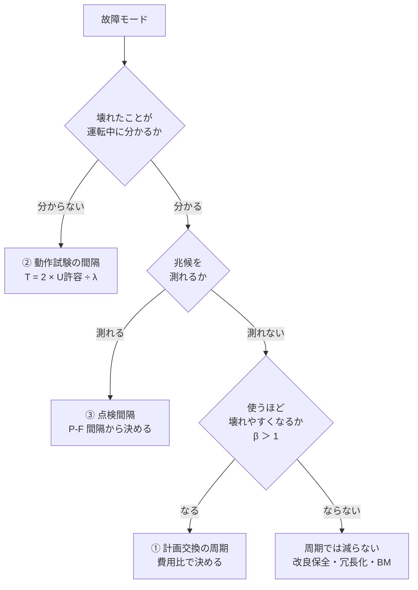

# 故障率と保全周期の決め方

## 30秒まとめ

保全周期は「メーカー推奨」「前任者の周期」「平均寿命 × 係数」で決めがちですが、**正しい式は故障の型ごとに違います**。摩耗で壊れる部品の交換周期は**故障時と計画交換の費用比**で、壊れても表に出ない機器の試験周期は**許容する機能喪失の確率と故障率**で、兆候が測れる故障の点検周期は**兆候が出てから壊れるまでの時間（P-F 間隔）**で決まります。どの式も入力は自工場の故障記録です。**点検のたびに「見つけたときの状態（as-found）」を記録しない限り、周期は永久に見直せません。**

---

## 先に決めること — 周期の式は故障の型で変わる

1 台の設備にも複数の壊れ方があります。周期は設備ごとではなく、**故障モードごと**に決めます（モードの割り方は [故障モード棚卸し](failure-mode-inventory.md) が正典）。

| 故障の型 | 例 | 周期を決める量 | 本ページの節 |
|---|---|---|---|
| 摩耗故障で、壊れると表に出る | 電磁弁のシール、接触器の接点、軸受 | 故障時と計画交換の費用比・ワイブルの形状 β | [① 計画交換](#replacement) |
| 壊れても表に出ない（隠れ故障） | 保護継電器、待機機の自動起動、警報・インターロック | 動作要求の頻度・許容する多重故障の頻度・隠れ故障率 | [② 動作試験](#hidden-failure) |
| 劣化の兆候が測れる | 接続部の過熱、絶縁抵抗の低下、振動の増加 | P-F 間隔・対処に要する時間・1 回の点検で見つける確率 | [③ 点検](#p-f-interval) |
| 測定値がずれていく | 伝送器・指示計のドリフト | 許容誤差・ドリフト速度・校正の不確かさ | [④ 校正](#calibration-interval) |
| 偶発故障で、兆候も無い | サージによる電子基板の破損 | 周期では減らせない | 改良保全・冗長化・予備品（[保全体系](maintenance-system.md)） |



!!! warning "安全・環境に効く故障は費用で決めない"
    ①の費用最適は、故障の結果が**お金で比べられる**ときの方法です。故障が人身・漏洩・火災に直結するモードは、費用ではなく「その方式でリスクが許容できる水準まで下がるか」で決めます。下がらないなら周期を詰めるのではなく、設計変更・冗長化を選びます。安全計装（SIS）の試験周期は SIL 検証で決まる別系統の要求です（[SIS・SIL](../03-keiso/sis-sil.md)）。

---

## 故障率を自工場の記録から求める

### 「故障率」という語は 2 つの意味で使われる

| 意味 | 単位 | 例 |
|---|---|---|
| 単位時間あたりに故障する割合（本ページの λ） | /h、/年、FIT | 0.004 /台年 ＝ 1 台を 1 年使うと平均 0.004 回壊れる |
| ある期間までに故障した台数の割合（累積故障確率 F） | % | 5 年で 18 % が故障した |

報告書で「故障率 2 %」とだけ書かれていたら、どちらかを確認してください。前者を後者と読むと、期間の長さだけ桁がずれます。

### 単位をそろえる

```text
1 FIT ＝ 1 × 10⁻⁹ /h（10 億時間に 1 回）
1 × 10⁻⁶ /h ＝ 1,000 FIT ＝ 8.76 × 10⁻³ /年（連続運転 8,760 h/年 として）
MTBF ＝ 1 ÷ λ（故障率が時間によらず一定のときだけ）
```

!!! danger "MTBF 114 年は「114 年もつ」ではありません"
    λ ＝ 1 × 10⁻⁶ /h は MTBF に直すと約 114 年です。しかし故障率が一定なら、**MTBF の時点までに約 63 % が壊れます**（残っている割合 ＝ e⁻¹ ≈ 37 %）。MTBF は「多数の台数を並べたときに、どれだけの頻度で故障対応が発生するか」を表す量で、1 台の寿命ではありません。寿命の長さを言いたいときは、後述の B10 寿命（10 % が壊れるまでの時間）を使います。MTBF・MTTF の定義は [保全体系](maintenance-system.md) が正典です。

### 分母は「台数 × 期間」

故障率は**故障件数 ÷ 延べ運転時間**です。件数だけを比べてはいけません。

```text
λ ＝ 故障件数 r ÷ 延べ運転時間 T
例：同形式の伝送器 200 台を 5 年使い、4 件故障
    T ＝ 200 台 × 5 年 ＝ 1,000 台年
    λ ＝ 4 ÷ 1,000 ＝ 0.004 /台年（0.4 %/年）
```

- 期間の途中で設置・撤去した台は、**実際に使っていた期間だけ**を分母に入れます
- 待機機のように普段止まっている機器は、運転時間と待機時間で壊れ方が違います。「運転中の故障」と「起動要求時の失敗」を分けて数えます
- 同じ台が 2 回壊れたら 2 件です。修理して使い続けたなら、修理後の期間も分母に入ります

### 件数が少ないときは「上限」で見る

A ランク設備の故障は年に数件しか起きません。4 件や 0 件から求めた λ は、偶然で大きく揺れます。**片側の信頼上限**で「悪くてもこの程度」を押さえます。

```text
故障 0 件のとき：λ上限 ＝ −ln(1 − 信頼度) ÷ T
    信頼度 60 %：0.92 ÷ T　　信頼度 90 %：2.30 ÷ T
故障 r 件のとき：λ上限 ＝ χ²（信頼度, 自由度 2r + 2）÷ (2T)
    Excel では =CHISQ.INV(信頼度, 2*r+2)/(2*T)
```

右の 2 列は、信頼度ごとの片側の信頼限界（悪い側の値）です。

| 記録 | 点推定 r ÷ T | 信頼度 60 % | 信頼度 90 % |
|---|---|---|---|
| 1,000 台年で 4 件 | 0.0040 /台年 | 0.0052 /台年 | 0.0080 /台年 |
| 150 台年で 1 件 | 0.0067 /台年 | 0.013 /台年 | 0.026 /台年 |
| 150 台年で 0 件 | 0（真の故障率が 0 とは限らない） | 0.0061 /台年 | 0.015 /台年 |

!!! warning "故障 0 件は「故障率 0」ではありません"
    150 台年で 0 件でも、90 % 上限は 0.015 /台年（MTBF に直すと約 65 年）にとどまります。「1 回も壊れていないから周期を延ばせる」と判断するには、上限値を使って次節以降の式に入れ直してください。

### 年齢帯ごとに分けて、故障の型を見分ける

全期間の λ を 1 つ出しただけでは、摩耗か偶発かが分かりません。**使用年数の帯ごと**に、その帯の延べ台年を分母にして率を出します。

| 使用年数の帯 | 延べ台年 | 故障件数 | 故障率 |
|---|---|---|---|
| 0〜5 年 | 500 | 5 | 1.0 %/年 |
| 5〜10 年 | 300 | 6 | 2.0 %/年 |
| 10〜15 年 | 100 | 6 | 6.0 %/年 |

（数値は説明用の架空例）件数は 5・6・6 で横ばいに見えますが、率は 1 → 2 → 6 %/年と上がっています。**古い帯ほど台数が少ないので、件数だけを見ると摩耗を見逃します。** 率が上がっていれば摩耗（①の計画交換が効く）、横ばいなら偶発（周期交換は効かない）、最初の帯だけ高ければ初期故障です。

### メーカー値・文献値を使うとき

自工場の記録が足りないときは、メーカーの故障率データや公開データベースの値を出発点にします。ただし次の点を確認してください。

- **故障の定義が違います。** メーカー値は「メーカーが故障と認定したもの」だけを数えていることが多く、現場の「誤指示で交換した」「調整で直った」は入っていません
- **使用条件が違います。** 周囲温度・振動・腐食性ガスで故障率は変わります。化学プラントの屋外設置は、試験室条件より悪い側に寄ります
- **自工場の記録が貯まったら置き換えます。** 文献値と自工場値の差が大きいときは、故障の定義・数え方を先に疑います

---

## ワイブル解析で「摩耗の強さ」を測る

故障した時点（年数・動作回数）の記録が 5 件以上あれば、ワイブル分布を当てはめて摩耗の強さを数字にできます。

```text
F(t) ＝ 1 − exp{ −(t ÷ η)^β }
    F(t)：時点 t までに故障する確率
    β（形状パラメータ）：壊れ方の型
    η（尺度パラメータ）：63.2 % が故障する時点（特性寿命）
平均寿命 ＝ η × Γ(1 + 1/β)　（Excel では =η*EXP(GAMMALN(1+1/β))）
B10 寿命 ＝ η × {−ln(0.9)}^(1/β)
```

| β の値 | 故障率の動き | 計画交換（TBM） |
|---|---|---|
| β < 1 | 時間とともに下がる（初期故障） | 逆効果。交換のたびに初期故障を持ち込む |
| β ≈ 1 | 一定（偶発故障） | 効かない |
| β > 1 | 時間とともに上がる（摩耗故障） | 効く。β が大きいほど寿命がそろい、効き目が大きい |

### 手順（打ち切りデータを捨てない）

記録には「壊れた台」と「まだ壊れていない台（運転中・別理由で撤去）」が混ざります。後者を**打ち切り（サスペンション）**と呼びます。

1. 全台を、故障または打ち切りの時点の小さい順に並べる（台数 N）。故障と打ち切りが同じ時点なら、故障を先に置く
2. 各台に**逆順位**（大きい側から数えた順位。先頭が N、末尾が 1）を振る
3. 故障した台だけ、**調整順位**を更新する：調整順位 ＝ {逆順位 × 直前の調整順位 ＋ (N ＋ 1)} ÷ (逆順位 ＋ 1)（直前の初期値は 0）
4. 中央ランク ＝ (調整順位 − 0.3) ÷ (N ＋ 0.4) を F の推定値にする
5. 横軸 x ＝ ln(t)、縦軸 y ＝ ln{−ln(1 − F)} で点を打ち、直線を当てはめる。**傾きが β**、y ＝ 0 となる t が η

### 計算例：電磁弁 10 台の動作回数

（数値は説明用の架空例。F＝故障、S＝打ち切り。単位は万回）

| 動作回数 | 状態 | 逆順位 | 調整順位 | 中央ランク F |
|---|---|---|---|---|
| 80 | S | 10 | — | — |
| 120 | F | 9 | 1.10 | 0.077 |
| 150 | S | 8 | — | — |
| 180 | F | 7 | 2.34 | 0.196 |
| 200 | S | 6 | — | — |
| 230 | F | 5 | 3.78 | 0.335 |
| 260 | S | 4 | — | — |
| 290 | F | 3 | 5.59 | 0.508 |
| 300 | S | 2 | — | — |
| 350 | F | 1 | 8.29 | 0.769 |

5 点に直線を当てはめる（x を y で回帰する方法）と、**β ≈ 2.7、η ≈ 317 万回**です。平均寿命は約 282 万回、B10 寿命は約 138 万回になります。

!!! warning "打ち切りを捨てると寿命を短く見積もります"
    同じ記録から故障の 5 台だけで計算すると η ≈ 267 万回となり、約 16 % 短く出ます。「まだ壊れていない台」は「長持ちしている」という情報を持っています。

!!! warning "5 件では β が 1 程度ぶれます"
    同じデータを最尤法で解くと β ≈ 3.7 になります。故障 5 件程度では推定方法だけで β がこれだけ動くので、**「β > 1 かどうか」の判定には使えても、β ＝ 2.7 を精密な値として扱ってはいけません**。周期を決めたら、次節の表で β を前後に動かしても結論が変わらないかを確かめてください。動かした結果 β が 1 以下になるなら、「計画交換が効くかどうか」から判断が分かれています。周期の値を詰める前に、年齢帯別の故障率で摩耗かどうかを確かめ直してください。

---

## ① 摩耗故障の計画交換 — 費用比で周期を決める { #replacement }

### 考え方

周期 T で計画交換すると、交換費用は増え、故障は減ります。最適な T は、**単位時間あたりの期待費用**が最小になる点です。

```text
単位時間あたりの期待費用 C(T) ＝ {Cp × R(T) ＋ Cf × F(T)} ÷ ∫₀ᵀ R(t) dt
    Cp：計画交換 1 回の費用（部品 ＋ 計画作業）
    Cf：故障 1 回の費用（部品 ＋ 緊急作業 ＋ 生産損失 ＋ 二次被害）
    R(T) ＝ 1 − F(T)：T まで壊れずに残る確率
    分子：1 サイクル（交換または故障まで）の期待費用
    分母：1 サイクルの期待長さ
```

故障すれば T を待たずにその場で交換し、交換後は新品に戻る、という前提です。

### 最適周期の早見表

最適周期 T* を**平均寿命に対する倍率**で示します。下段の % は、壊れるまで使う場合に比べた期待費用の削減率です。

| β ＼ 費用比 Cf/Cp | 2 | 5 | 10 | 20 |
|---|---|---|---|---|
| 1.5 | 2.41 倍（0.2 %） | 0.75 倍（11 %） | 0.42 倍（25 %） | 0.25 倍（39 %） |
| 2 | 1.23 倍（3 %） | 0.58 倍（28 %） | 0.38 倍（46 %） | 0.26 倍（61 %） |
| 3 | 0.91 倍（12 %） | 0.56 倍（46 %） | 0.43 倍（65 %） | 0.33 倍（77 %） |
| 4 | 0.85 倍（19 %） | 0.59 倍（55 %） | 0.48 倍（72 %） | 0.40 倍（83 %） |

読み方は 3 つです。

- **費用比が小さい（2 程度）と、計画交換はほとんど得になりません。** β ＝ 1.5 では最適周期が平均寿命の 2.4 倍、削減率は 0.2 % で、実質「壊れるまで使う」が最適です
- **費用比が大きいほど、平均寿命よりかなり手前で替えるのが最適です。** 生産停止を伴う部品は Cf/Cp が 10 を超えることが珍しくありません
- **[保全体系](maintenance-system.md) の「平均寿命 × 0.6〜0.8」は、β ＝ 2〜6 では費用比がおよそ 2〜8 の部品の最適周期に当たります**（0.8 倍が最適になる費用比は 2.2〜3.2、0.6 倍は 4.3〜7.7。費用比 3〜4 なら最適倍率は 0.62〜0.83 倍に収まる）。費用比が 10 を超える部品や、β が 2 より小さい部品に当てると、周期が長すぎるか短すぎます（β ＝ 1.5 では費用比 3 の最適倍率が 1.28 倍）

### 計算例：上の電磁弁（β ≈ 2.7、η ≈ 317 万回、平均寿命 約 282 万回）

| 費用比 Cf/Cp | 最適周期 T* | T* までに壊れる割合 | 壊れるまで使う場合からの削減 |
|---|---|---|---|
| 3（予備機があり、故障しても生産は止まらない） | 約 204 万回（平均寿命の 0.72 倍） | 26 % | 24 % |
| 10（故障するとラインが数時間止まる） | 約 116 万回（平均寿命の 0.41 倍） | 6.4 % | 61 % |

費用比 10 のときに「平均寿命 × 0.7 ＝ 約 197 万回」を使うと、期待費用は最適周期より約 25 % 高くなり、交換前に約 24 % が壊れます。**同じ部品でも、どの系統に付いているかで最適周期は 2 倍近く変わります。** 計算した周期は切り捨てて丸めます（切り上げると故障側に寄ります）。

!!! tip "Excel で解くとき"
    **先に β ＞ 1 であることを確かめます。** β ≤ 1 では最適周期が存在せず（壊れるまで使うのが最適）、計算すると探した範囲の端が「最適」に見えます。

    T を 0.05η から 3η まで 0.05η 刻みで並べた列を作り、各 T について分母の積分を台形則（R(t) を細かく刻んで足す）で計算し、C(T) が最小の行を探します。**最小が範囲の端（3η）に来たら、計画交換は得にならないと読みます。** β を前後に動かした表も並べ、最適周期がどれだけ動くかを確認してください。

---

## ② 隠れ故障の動作試験 — 試験間隔を決める { #hidden-failure }

保護継電器・待機機の自動起動・インターロックは、壊れても平常運転には何も現れません。**故障は次の試験か、本当に動作が要求されたときに初めて見つかります。**

### 考え方

試験の間に故障が一様に起きるとすると、壊れてから見つかるまでの時間は平均で試験間隔の半分です。

```text
平均の機能喪失確率 U ≈ λ × T ÷ 2　（λT が 0.1 程度以下で使える近似）
    λ：隠れ故障の故障率　T：試験間隔
試験間隔 T ＝ 2 × U許容 ÷ λ
U許容 ＝ 許容できる多重故障の頻度 ÷ 動作要求の頻度
    多重故障：保護機能が壊れている間に、保護が必要な事象が起きること
```

### 計算例

（数値は説明用の架空例）ある地絡保護の継電器について：

- 動作要求（地絡事故）の頻度：0.1 回/年（10 年に 1 回）
- 許容できる多重故障（保護不動作による波及事故）の頻度：0.001 回/年
- U許容 ＝ 0.001 ÷ 0.1 ＝ 0.01
- 継電器の隠れ故障率：λ ＝ 0.01 /年
- 試験間隔 T ＝ 2 × 0.01 ÷ 0.01 ＝ **2 年**（λT ＝ 0.02 なので近似の誤差は 1 % 未満）
- 保安規程でこれより短い試験頻度を定めていれば、保安規程の頻度が優先します（下記「最後に周期を決める」）

!!! warning "試験間隔は短いほどよい、ではありません"
    - 試験中は保護が外れている（または外して試験する）ので、その時間も機能喪失に加わります
    - 試験の作業そのものが誤結線・整定の戻し忘れという故障を持ち込みます
    - 試験で見つけられない故障（例：試験端子より先の回路）は、何度試験しても見つかりません。その部分の λ は U に残り続けます

    周期を詰める前に、試験の範囲（どこからどこまで確認しているか）が故障モードを覆っているかを確認してください。

!!! note "安全計装の PFDavg と同じ式です"
    [SIS・SIL](../03-keiso/sis-sil.md) の低頻度作動要求モードの近似 PFDavg ≈ λDU × T ÷ 2 は、上の U と同じ式です。ただし SIS の試験間隔は SIL 検証計算で決まる要求で、本節の「許容する多重故障の頻度」を現場で置いて決めてよいものではありません。

---

## ③ 兆候が測れる故障の点検 — P-F 間隔から決める { #p-f-interval }

### P-F 間隔とは

劣化の兆候が測定で検出できるようになった時点を P（potential failure）、機能を失う時点を F（functional failure）と呼びます。P から F までの時間が **P-F 間隔**です。点検は、この間に少なくとも 1 回（確実に見つけたいなら複数回）入らなければ意味がありません。

```text
点検間隔 I ≤ (P-F 間隔 − 対処リードタイム) ÷ n
    対処リードタイム：兆候を見つけてから処置を終えるまでに要る時間（部品手配・停電調整）
    n：1 回の点検で兆候を見つける確率 p について、1 − (1 − p)ⁿ が目標を超える最小の回数
```

対処リードタイムを引くのは、F の直前に見つけても処置が間に合わないからです。

### 計算例

（数値は説明用の架空例）盤内の接続部の過熱をサーモグラフィで見つける場合：

- 自工場の記録で、温度上昇が判定基準を超えてから焼損に至るまでが最も短かった例で 6 ヶ月（P-F 間隔はばらつくので、平均ではなく**最も短い側**を使う）
- 停電を調整して増し締めするまでに 1 ヶ月
- 1 回の測定で見つける確率 p ＝ 0.8（負荷が軽い日に測ると見逃す）、目標 95 %
- n ＝ 1 では 80 %、n ＝ 2 では 1 − 0.2² ＝ 96 % → n ＝ 2
- 点検間隔 I ≤ (6 − 1) ÷ 2 ＝ 2.5 ヶ月 → **2 ヶ月ごと**

RCM（信頼性中心保全）の文献には「点検間隔は P-F 間隔の半分」という目安があります。上の式で、対処リードタイムが短く、目標 95 % に対して 1 回で見つける確率 p が 0.78 以上 0.95 未満のときの n ＝ 2 に相当します。p がこれより低ければ半分では足りません（p ＝ 0.75 なら n ＝ 3）。

!!! tip "P-F 間隔は最初は分からない。記録から作る"
    最初は短めの間隔で始め、兆候を見つけたら「その後も放置したらいつ壊れたか」を推定できる値（温度上昇の傾き、絶縁抵抗の低下速度）を記録します。トレンドの取り方は [データ活用・予兆保全](predictive-maintenance.md)、測定条件と判定は [サーモグラフィ診断](thermography.md)、絶縁抵抗の判定値は [絶縁管理](insulation-management.md) が正典です。

---

## ④ 校正 — as-found とドリフトで周期を決める { #calibration-interval }

### ドリフト速度から上限を出す

```text
校正間隔の上限 ≈ (許容誤差 − 校正直後の残差 − 校正の不確かさ) ÷ ドリフト速度
    ドリフト速度：|今回の as-found − 前回の as-left| ÷ 経過年数（ずれの向きによらず絶対値で見る）
```

（数値は説明用の架空例）許容誤差 ±0.5 %、校正直後の残差 0.05 %、校正の不確かさ 0.10 %、同形式の伝送器で記録上最大のドリフト速度 0.15 %/年：

- (0.5 − 0.05 − 0.10) ÷ 0.15 ≈ 2.3 年 → **2 年**

不確かさを単純に引いているのは保守側の簡略化です。ドリフトは一方向に直線的に進むとは限らないので、**同形式の中で最も速い値**を使います。

### 校正結果で周期を伸縮させる

校正間隔の決め方には、**校正のたびに結果で次の間隔を伸縮させる方法**（許容誤差内なら延ばし、外れたら縮める）と、**管理図で変化を追う方法**があります。国際的な指針として ILAC-G24／OIML D 10「Guidelines for the determination of recalibration intervals of measuring equipment」（2022 年版）が知られています（本文は未照合。下記「根拠」）。

!!! danger "調整する前に、まず as-found を記録する"
    校正で「ずれていたので合わせた」とだけ記録すると、**ずれていた量が残らず、ドリフト速度も許容誤差内だったかも分かりません。** すると周期を延ばす根拠が永久に作れません。手順は「as-found を記録 → 調整 → as-left を記録」の順です。校正手順そのものは [校正](calibration.md) が正典です。

---

## 最後に周期を決める — 上限・停止窓・見直し

①〜④で出した周期は**技術的な周期**です。実際の周期は次の順で決めます。

1. **上限で切る。** 保安規程で定めた点検頻度、法令の検査周期、メーカーの保証条件、社内で重要度ランクごとに定めた周期（例：[校正](calibration.md) の A ランク設備）のうち、技術的な周期より短いものがあればそちらを使います。頻度の数値は本ページでは扱いません（[法定業務一覧](../09-hoantokei/legal-duties.md)・[保安規程の管理](../09-hoantokei/hoan-kisoku.md)）
2. **停止の窓に合わせる。** 停電や T/A でしか作業できないものは、技術的な周期を**超えない**最後の窓に前倒しします。次の窓まで延ばすと、その差の分だけ故障側に寄ります
3. **同じ窓に集める。** 周期がわずかに違う作業は、短い側に合わせて同じ停止にまとめると停止回数が減ります。短い側に合わせるのであって、長い側ではありません
4. **as-found を記録して見直す。** 点検・交換・校正のたびに「見つけたときの状態」を残し、年 1 回など決めた時期に、本ページの式に入れ直します

| 見直しで見えたこと | 次の打ち手 |
|---|---|
| 交換した部品がほとんど健全だった（摩耗が進んでいない） | 周期を延ばす候補。ワイブルの打ち切りデータとして使う |
| 周期の前に壊れるものが多い | 周期を詰めるか、β が小さく寿命がばらつく型なので CBM に切り替える |
| 交換・分解の直後に故障が集まる | 初期故障か作業ミス。周期を詰めると悪化する（[保全体系](maintenance-system.md)） |
| 試験で隠れ故障が毎回のように見つかる | λ が想定より大きい。②の式で間隔を詰めるか、冗長化・設計変更 |
| 校正の as-found が許容誤差外 | 周期を縮める。さらに、外れていた期間の測定値に頼った判断（品質・安全）を遡って確認する |

---

## よくある誤解

| 誤解 | 正しい理解 |
|---|---|
| MTBF 10 年の機器は 10 年もつ | 故障率が一定なら、10 年までに約 63 % が壊れる。寿命を言うなら B10 寿命などを使う |
| 故障が 0 件だから故障率は 0 | 延べ運転時間が短いだけかもしれない。信頼上限で見る |
| 周期は短いほど安全 | 摩耗以外の型では故障は減らない。分解・試験そのものが故障を持ち込む |
| メーカー推奨周期が正解 | メーカーの使用条件と故障の数え方を前提にした値。自工場の記録で補正する |
| 平均寿命の 0.7 倍で交換すれば合理的 | 費用比と β で最適周期は大きく変わる。同じ β ＝ 2.7 でも費用比 3 なら 0.72 倍、費用比 10 なら 0.41 倍 |
| 交換した部品は捨てて終わり | 交換時の状態は、周期を延ばせるかどうかを決める唯一のデータ |

---

## 根拠

### 本ページが正典の範囲

故障率の求め方（単位・分母・信頼上限・年齢帯別の率）、ワイブル解析の手順、故障の型ごとの周期の式（①〜④）、周期の最終決定と見直しの手順は本ページが正典です。

| 本ページで再掲しないもの | 正典 |
|---|---|
| MTBF・MTTR・稼働率の定義、バスタブ曲線、保全方式の区分、重要度ランク | [保全体系](maintenance-system.md) |
| 安全計装のプルーフテスト周期と PFDavg | [SIS・SIL](../03-keiso/sis-sil.md) |
| 部品の寿命目安（年数・動作回数） | [寿命管理](lifetime.md) |
| 校正の手順・トレーサビリティ | [校正](calibration.md) |
| 点検頻度の法的な位置づけ | [法定業務一覧](../09-hoantokei/legal-duties.md)・[保安規程の管理](../09-hoantokei/hoan-kisoku.md) |

### 本ページに法定数値は登場しません

本ページの数値はすべて、信頼性工学の一般原理による計算と、説明用の架空例です。法令・規格の規定値はありません。

- **一般原理（規格の規定値ではない）**: 故障率一定のときの R ＝ e^(−λt)、故障件数がポアソン分布に従うとしたときの信頼上限（χ² 分布との関係）、ワイブル分布、調整順位と中央ランクの近似、計画交換の期待費用率（再生報酬過程による年齢交換モデル）、隠れ故障の平均機能喪失確率 λT/2、P-F 間隔の考え方は、いずれも信頼性工学・保全工学の教科書的な内容です。特定の規格の条文として引用していません
- **架空例**: 伝送器 200 台の記録、年齢帯別の故障件数、電磁弁 10 台の動作回数、地絡保護の動作要求頻度と許容値、接続部過熱の P-F 間隔、伝送器のドリフト速度は、すべて説明用に置いた値です。実機の代表値ではありません
- **「P-F 間隔の半分」**: RCM の文献で使われる目安です。本ページでは、検出確率から n を決める式の特別な場合として位置づけ直しました。規格の規定値としては扱っていません

### 計算の検算（2026-10-19）

本ページの数値は、すべて Python で独立に計算し直して確認しました。

| 項目 | 方法 | 結果 |
|---|---|---|
| 1 × 10⁻⁶ /h の換算 | 直接計算 | 1,000 FIT・8.76 × 10⁻³ /年・MTBF 114.2 年。R(MTBF) ＝ 0.368 |
| 係数 0.6〜0.8 の逆算 | 最適倍率がちょうど 0.8・0.6 になる費用比を二分法で探索 | 0.8 倍：2.21〜3.15、0.6 倍：4.29〜7.74（β ＝ 2・2.7・3・4・6）。β ＝ 1.5 では費用比 3 で 1.28 倍、4 で 0.93 倍 |
| 片側信頼限界 | ポアソン累積確率 ＝ 1 − 信頼度 となる λT を二分法で解く | 4 件/1,000 台年：信頼度 60 % で 0.00524、90 % で 0.00799。1 件/150 台年：90 % で 0.0259。0 件/150 台年：60 % で 0.00611、90 % で 0.01535。1 件/150 台年の 60 %：0.0135 |
| ワイブル例 | 調整順位（逆順位による漸化式）・中央ランク (i − 0.3)/(N + 0.4)・x を y で回帰 | β ＝ 2.66、η ＝ 316.6 万回。y を x で回帰すると β ＝ 2.65、η ＝ 317.4。最尤法（打ち切りを含む）は β ＝ 3.66、η ＝ 301.9。故障 5 件だけでは η ＝ 267.0 |
| 平均寿命・B10 | Γ 関数で計算 | β ＝ 2.7、η ＝ 317 のとき平均 281.9 万回、B10 137.7 万回 |
| 最適交換周期 | C(T) の分母をシンプソン則で数値積分し、T を格子探索 | 早見表の各値。β ＝ 2.7・費用比 10 で T* ＝ 115.8 万回、F(T*) ＝ 0.064、0.7 倍周期（197.3 万回）の期待費用は最適の 1.254 倍、F ＝ 0.243 |
| 「0.6〜0.8 倍」の費用比 | 同上 | 費用比 3 で 0.71〜0.83 倍、費用比 4 で 0.62〜0.69 倍（β ＝ 2・2.7・3・4・6） |
| 隠れ故障の近似 | 厳密式 U ＝ 1 − (1 − e^(−λT))/(λT) と比較 | λT ＝ 0.02：厳密 0.00993、近似 0.01。λT ＝ 0.2：厳密 0.0937、近似 0.1 |

[保全体系](maintenance-system.md) の warning にある「平均寿命の 0.7 倍で交換したときに交換前に壊れる割合（β ＝ 2 で約 32 %、β ＝ 6 で約 7 %）」も同じ方法で再計算し、0.319・0.072 で一致することを確認しました。

### 原本未照合（honest-hold）

- **ILAC-G24／OIML D 10**: 2026-10-19 にウェブ検索ツールが返した要約（OIML の公開 PDF を出典として示したもの）で、2022 年版の表題が「Guidelines for the determination of recalibration intervals of measuring equipment」であること、目次で校正結果に応じて間隔を自動調整する方法（staircase）と管理図の方法が挙げられていることが示されました。**これは二次資料（検索ツールの要約）で、作成環境と監査環境のどちらからも原本 PDF に接続できず、本文は読んでいません。** 間隔の伸縮幅などの具体的な手順は本ページに書いていません。使う場合は原本に当たってください
- **故障率・ワイブル解析・RCM の規格**: 故障率の推定、ワイブル解析、RCM を扱う IEC・JIS の規格はありますが、本 Wiki では原本を入手・照合していないため、規格番号と要求事項を引用していません

### 限界の明示

- **少ないデータの推定は不確かです。** 本ページの式は、入力の λ・β・費用比が確からしいことを前提にしています。故障数件のデータでは、上限値で計算した結果と点推定で計算した結果を並べ、周期の判断がどちらでも変わらないかを確かめてください
- **モデルの前提があります。** ①は「交換すれば新品に戻る」「故障はすぐに分かる」「費用は毎回同じ」、②は「隠れ故障の故障率が時間によらず一定」「試験で隠れ故障をすべて見つけられる」「試験で新たな故障を持ち込まない」（隠れ故障が摩耗型なら、λT/2 は機能喪失確率を小さく見積もる）、③は「兆候は P-F 間隔のあいだ検出できる」、④は「ドリフトは一方向に進む」を前提にしています。前提が崩れる設備では結果を目安として扱ってください
- **安全計装・法定の検査周期には本ページの式で上書きしません。** 周期の上限を決めるのは保安規程・法令・SIL 検証です

## 関連ページ

- [保全体系](maintenance-system.md) — 保全方式の区分・バスタブ曲線・MTBF/MTTR の定義
- [故障モード棚卸し](failure-mode-inventory.md) — 周期を決める単位となる故障モードの割り方
- [寿命管理](lifetime.md) — 部品の寿命目安。ワイブル解析の出発点として使う
- [データ活用・予兆保全](predictive-maintenance.md) — P-F 間隔を推定するためのトレンド管理
- [校正](calibration.md) — as-found・as-left を記録する校正手順
- [SIS・SIL](../03-keiso/sis-sil.md) — プルーフテスト周期と PFDavg（②と同じ式の、別系統の要求）
- [予備品管理](spare-parts.md) — 重要予備品の選定・在庫管理
